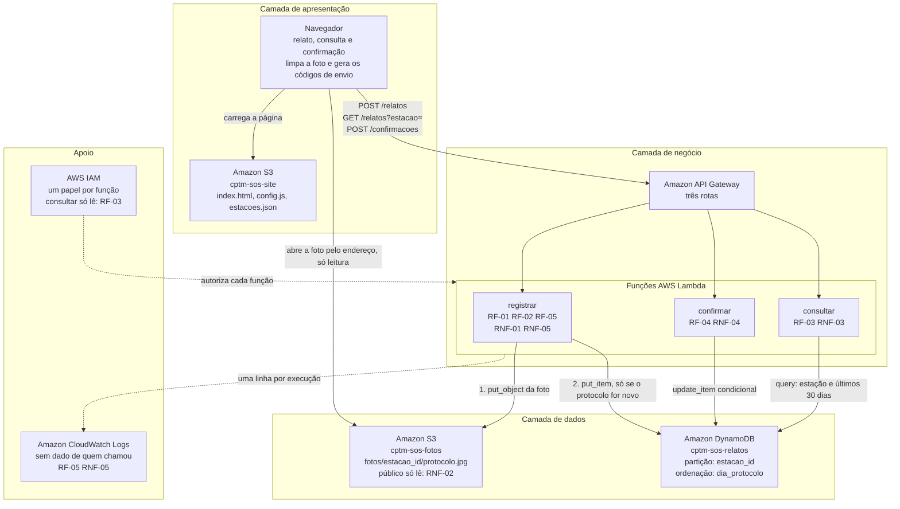

# Diagrama de arquitetura — CPTM SOS · Relatos por estação

Entregável da Sprint 2, seção 5. O diagrama foi feito no Lucidchart, no
documento "CPTM SOS - Arquitetura (Sprint 2)", e a imagem exportada de lá está em
[`diagrama.png`](diagrama.png). Ele foi gerado pelo recurso "Diagrama em código"
do Lucidchart, a partir do código Mermaid abaixo, que o GitHub também desenha ao
abrir este arquivo. Para mudar o desenho, mude o código e gere de novo no Lucidchart.

## Como ler

As setas cheias são o caminho do dado. As pontilhadas são autorização e
registro: não carregam dado da passageira, mas sem elas nada funciona e nada é
auditável. As duas pontilhadas valem para as três funções: cada função tem o
seu papel no IAM, e cada uma deixa uma linha no CloudWatch Logs.

**Nenhuma seta liga o navegador à tabela.** O único caminho até os relatos passa
pelo API Gateway e por uma função, como descreve a seção 2.1 do documento de
arquitetura. A única seta do navegador até a camada de dados é a da foto, e ela
é só de leitura: o navegador abre uma foto cujo endereço já recebeu, sem poder
listar o bucket, gravar ou apagar (RNF-02).

A função `registrar` tem duas setas de saída, numeradas porque a ordem importa:
primeiro a foto, depois o relato. É a preocupação de Reliability do FURPS — não
pode existir relato listado apontando para uma foto que nunca subiu.

O papel do IAM da `consultar` só permite ler a tabela: é ele que cumpre o
RF-03, porque a função que responde à consulta não consegue alterar nenhum
relato.
