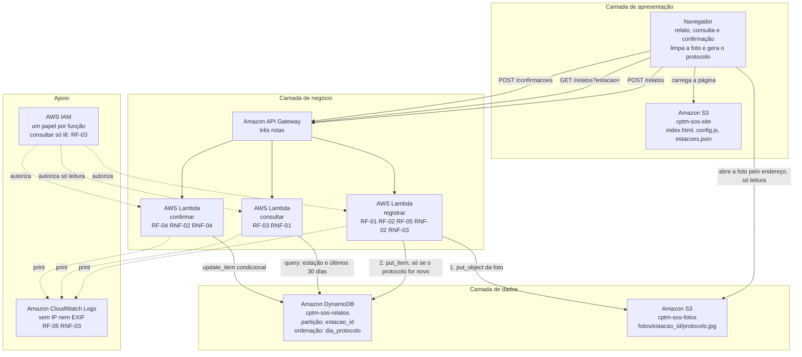

# Diagrama de arquitetura — CPTM SOS · Relatos por estação

Entregável da Sprint 2, seção 5. O diagrama foi feito no Lucidchart e está em
[`diagrama.png`](diagrama.png). Abaixo, a mesma versão em Mermaid, que o GitHub
desenha como imagem ao abrir este arquivo.

## Como ler

As setas cheias são o caminho do dado. As pontilhadas são autorização e
registro: não carregam dado da passageira, mas sem elas nada funciona e nada é
auditável.

**Nenhuma seta liga o navegador à tabela.** O único caminho até os relatos passa
pelo API Gateway e por uma função, como descreve a seção 2.1 do documento de
arquitetura. A única seta do navegador até a camada de dados é a da foto, e ela
é só de leitura: o navegador abre uma foto cujo endereço já recebeu, sem poder
listar o bucket, gravar ou apagar.

A função `registrar` tem duas setas de saída, numeradas porque a ordem importa:
primeiro a foto, depois o relato. É a preocupação de Reliability do FURPS — não
pode existir relato listado apontando para uma foto que nunca subiu.

A seta do IAM para a `consultar` diz "só leitura" porque é ela que cumpre o
RF-03: a função que responde à consulta não consegue alterar nenhum relato.
