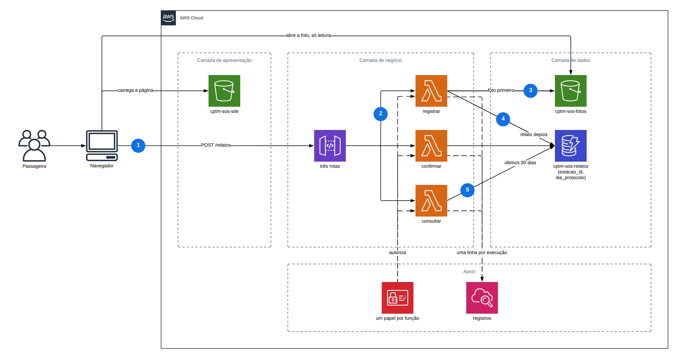

# Diagrama de arquitetura — CPTM SOS · Relatos por estação

Entregável da Sprint 2, seção 5. O diagrama foi feito no Lucidchart, no
documento "CPTM SOS - Arquitetura (Sprint 2)", página "Arquitetura AWS", sobre o
modelo "Estrutura horizontal AWS (2019)" e com o ícone oficial de cada serviço.

## Como ler

As setas cheias são o caminho do dado. As tracejadas são autorização e
registro: não carregam dado da passageira, mas sem elas nada funciona e nada é
auditável. As duas tracejadas valem para as três funções: cada função tem o seu
papel no IAM, e cada uma deixa uma linha no CloudWatch Logs.

As setas numeradas seguem um relato, do envio à consulta:

1. o navegador envia o relato ao API Gateway, em `POST /relatos`;
2. o API Gateway invoca a função `registrar`;
3. a `registrar` grava primeiro a foto, no bucket `cptm-sos-fotos`;
4. e só depois o relato, na tabela `cptm-sos-relatos`;
5. a `consultar` lê da tabela os relatos dos últimos 30 dias da estação.

A ordem de 3 e 4 é a preocupação de Reliability do FURPS: não pode existir
relato listado apontando para uma foto que nunca subiu.

**Nenhuma seta liga o navegador à tabela.** O único caminho até os relatos passa
pelo API Gateway e por uma função, como descreve a seção 2.1 do documento de
arquitetura. A única seta do navegador até a camada de dados é a da foto, e ela
é só de leitura: o navegador abre uma foto cujo endereço já recebeu, sem poder
listar o bucket, gravar ou apagar (RNF-02).

O modelo do Lucidchart traz VPC e sub-redes; elas foram tiradas, porque a
arquitetura é serverless e não roda dentro de uma VPC.

A versão anterior do diagrama, gerada a partir de código Mermaid, continua na
página "Arquitetura" do mesmo documento do Lucidchart e no histórico do
repositório.
